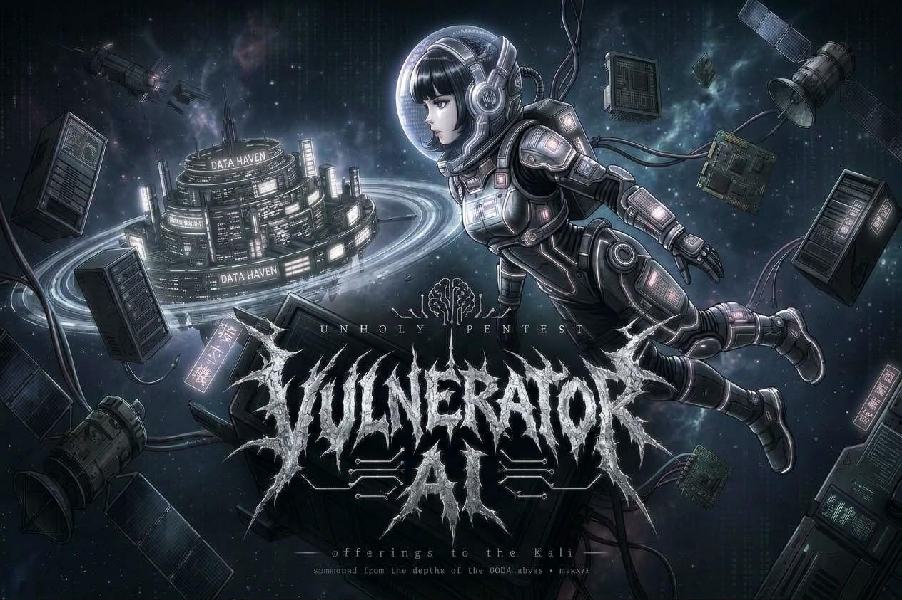
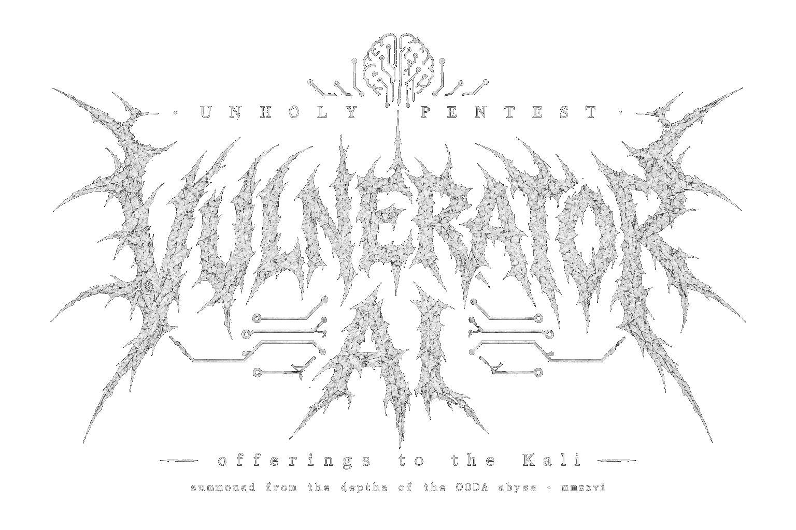
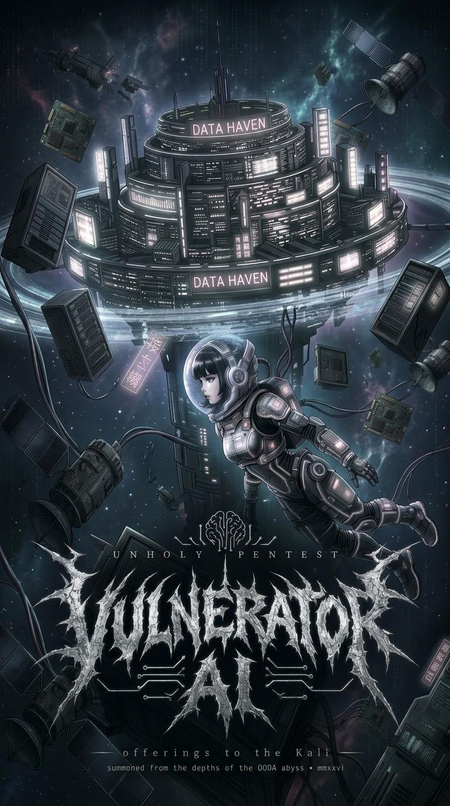

<p align="center">
  
</p>

<p align="center">
  <a href="https://github.com/irraz/vulnerator-ai/releases/latest">
    
  </a>
</p>

<p align="center">
  <sub><b>Built with</b></sub>
</p>

<p align="center">
  <a href="https://www.docker.com/">
    
  </a>
  &nbsp;
  <a href="https://hermes-agent.nousresearch.com/">
    
  </a>
  &nbsp;
  <a href="https://www.kali.org/">
    
  </a>
</p>

<p align="center">
  <sub>
    Containerized with <a href="https://www.docker.com/">Docker</a> &middot;
    driven by <a href="https://hermes-agent.nousresearch.com/">Hermes Agent</a> from
    <a href="https://nousresearch.com/">Nous Research</a> &middot;
    tooling on <a href="https://www.kali.org/">Kali Linux</a>
  </sub>
</p>

OODA pentest driven by **Hermes** talking **directly** to a **Kali** container via MCP.

## What it is

`vulnerator-ai` runs an OODA (Observe-Orient-Decide-Act) pentest loop where
the driving brain is [Hermes](https://github.com/NousResearch/hermes) and the
tools run on a Kali governed by an MCP server. Hermes decides what
to run and launches it **directly** against the target through the Kali MCP.

It is a deliberately minimal design: **no core, no REST API, no UI, no gates**.
Four containers (the agent, two tool MCP servers and the MCP front door) and the agent driving
end to end.

## Architecture (4 containers)

![Vulnerator AI system architecture: an MCP client (Claude Code / Kiro / BugTraceAI) drives a pentest THROUGH the vulnerator-mcp front door (MCP, :8700 internal), which forwards to Hermes' :8642 runs API over HTTP Bearer; an external assistant can still trigger/observe Hermes directly over :8642. Hermes is the OODA brain, reasoning with mistralai/mistral-large on OpenRouter and driving the kali-mcp (:8900) and playwright-mcp (:8931) servers over MCP; kali runs the pentest tools against the authorized target. ATT&CK is the Orient language of the loop.](docs/architecture.svg)

- **kali** — deterministic runtime for pentest and collection tools (nmap, Prowler,
  ScoutSuite, Cloudsplaining, ...). Exposes a `kali-mcp` server on `:8900` (and the artifacts
  channel on `:8901`).
- **playwright-mcp** — real browser (headless Chromium, official Microsoft image) exposed
  over MCP on `:8931`. Gives Hermes the web surface (navigation/DOM/interaction) without re-enabling
  any native toolset. The `web-pentest` skill uses it.
- **ooda-agent** — Hermes (`nousresearch/hermes-agent`) as the OODA loop driver. It is a client
  of both MCPs (`kali:8900`, `playwright-mcp:8931`) and runs the pentest tools directly.
  It keeps its gateway alive with `hermes gateway run` (OpenAI-compatible API server on `:8642`,
  **published to the host** by default so you can pilot it — see "Driving a pentest").

- **vulnerator-mcp** — a thin MCP **front door** over Hermes' `:8642` runs API so external MCP
  clients (Claude Code / Kiro, BugTraceAI, ...) can trigger/observe/steer/stop a pentest as MCP
  tools. It is **up by default** (4th container) because the intended UX is driving the engine
  from an MCP client. In the default stack it runs **streamable-HTTP on the internal network**
  (`http://vulnerator-mcp:8700`, **no host port**) and is **fail-closed** on
  `VULNERATOR_MCP_INBOUND_TOKEN`. For **local** Claude Code / Kiro the recommended path is instead
  the **stdio** mode (`docker run -i …`, zero network surface, no token). It wraps, does **not**
  replace, the HTTP API: it exposes **only** the runs lifecycle (no raw `kali_run`, no
  `/v1/chat/completions`) so the client stays a trigger/observer, never the brain. See "Driving a
  pentest → From an MCP client" below.

There are no `api` or `ui` services: the agent talks directly to the MCPs (Kali and browser),
and the MCP front door only forwards the runs lifecycle.

### Tools included in the Kali image

The Kali image bakes in a **curated** set of pentest CLIs the skills assume exist and invoke via
`kali_run` (the base `kalilinux/kali-rolling` image is minimal and ships none of them). This is a
deliberate, small selection — **not** the full `kali-linux-headless` metapackage — to keep the
image reasonably sized:

| Baked-in tool | Used for |
| --- | --- |
| `nmap` | network/port/service enumeration |
| `whatweb` | web tech fingerprinting |
| `nuclei` | templated vulnerability scanning |
| `ffuf` | web fuzzing |
| `sqlmap` | SQL injection testing |
| `gobuster` | directory/DNS/vhost brute forcing |
| `impacket-scripts` | Impacket CLI helpers (AD/network) — invoked with the `impacket-` prefix, e.g. `impacket-secretsdump`, `impacket-GetUserSPNs` |
| `bloodhound.py` | BloodHound Python ingestor (AD) — command `bloodhound-python` |

Plus the cloud-collection tooling in the Python venv (Prowler, ScoutSuite, Cloudsplaining, Pacu).
Anything else a specific engagement needs can still be `apt install`-ed on the fly inside the
`kali` container; note it lives in the container's ephemeral layer and disappears on the next
`down`/`up` (bake it into the `Dockerfile` to make it permanent — see "Start clean between
exercises").

## How to bring it up

**All keys and credentials go in a `.env` file** at the repo root. It is not
versioned (it is in `.gitignore`) and is the only place where you put secrets. Start by copying
the template, which documents every variable:

```sh
cp .env.example .env
```

Open the `.env` and fill in the values. At a minimum you need the three required ones:

| Variable | Required | Where to put it / how to get it |
| --- | --- | --- |
| `OPENROUTER_API_KEY` | **Yes** | Your OpenRouter API key (the provider of the LLM that reasons the OODA). Create it at <https://openrouter.ai/keys> and paste it into the `.env`. |
| `HERMES_API_SERVER_KEY` | **Yes** | Key for Hermes' API server (min. 8 chars). Generate one with `openssl rand -hex 32` and paste it into the `.env`. It is also the Bearer to pilot Hermes over HTTP. |
| `VULNERATOR_MCP_INBOUND_TOKEN` | **Yes** | Inbound Bearer for the `vulnerator-mcp` front door, which is **up by default** in streamable-HTTP mode. Generate one with `openssl rand -hex 32` and paste it into the `.env`. The default stack is **fail-closed** on this: `docker compose up` aborts without it. It is a **separate** secret from `HERMES_API_SERVER_KEY` and gates a different edge. (The local **stdio** mode for Claude Code / Kiro does not need it.) |

The **AWS credentials are OPTIONAL**: they are only needed if you are going to use the cloud
collection tools (Prowler / ScoutSuite / Cloudsplaining). If you are not auditing AWS, leave these
variables empty in the `.env`:

| Variable | Required | Where to put it / how to get it |
| --- | --- | --- |
| `AWS_ACCESS_KEY_ID` | No | **Read-only** credential for the account you are AUTHORIZED to audit. In the `.env`. |
| `AWS_SECRET_ACCESS_KEY` | No | Secret for that same credential. In the `.env`. |
| `AWS_SESSION_TOKEN` | No | Only for temporary credentials (STS). In the `.env`. |
| `AWS_REGION` | No | Default region (e.g. `us-east-1`). In the `.env`. |
| `OPENROUTER_MODEL` | No | Overrides the OpenRouter model Hermes reasons with. Empty = the profile default (`mistralai/mistral-large-4-0`). **Caveat:** the project uses Mistral Large on purpose because models like Claude (`anthropic/*`) refuse the authorized-offensive pentest framing (OpenRouter/Anthropic returns "violative cyber content"); overriding with such a model may make the agent refuse to work. |
| `VULNERATOR_MCP_HOST_PORT` | No | HOST port to publish the `vulnerator-mcp` streamable-HTTP server. By default it publishes **no** host port (internal docker network only). Set this **and** uncomment the service's `ports:` block in `docker-compose.yml` to publish on a controlled machine. |

The rest of the `.env.example` variables (host ports, artifacts token, Prowler
scoping) are optional and come with defaults; leave them empty unless you need to
change them. Once your `.env` is ready:

```sh
docker compose up -d --build
```

### Local inference with Ollama (optional)

By default Hermes reasons with Mistral Large on OpenRouter. If you prefer to run the model
yourself, you can point Hermes at an [Ollama](https://ollama.com) endpoint (OpenAI-compatible)
instead. This is **opt-in** and fully controlled from the `.env`:

| Variable | Required | Where to put it / how to get it |
| --- | --- | --- |
| `OLLAMA_BASE_URL` | No | Empty = use OpenRouter (default). Set it to an Ollama OpenAI-compatible endpoint to use Ollama instead: `http://host.docker.internal:11434/v1` for a local host Ollama, or `http://<host>:11434/v1` for a remote one. When set, `OPENROUTER_API_KEY` is **not** required. |
| `OLLAMA_MODEL` | No | The Ollama model name used in Ollama mode, e.g. `qwen2.5-coder:32b`. |

At startup the stack branches on `OLLAMA_BASE_URL`: when it is empty the OpenRouter path is used
exactly as before (and a missing `OPENROUTER_API_KEY` still aborts startup); when it is set, the
startup script runs `hermes config set model.provider custom`, `model.base_url <OLLAMA_BASE_URL>`
and `model.default <OLLAMA_MODEL>`, so Hermes talks to Ollama.

Caveats before you rely on it:

- **Context window (hard blocker):** Hermes refuses to start against an endpoint serving less than
  ~64K tokens of context, and Ollama defaults to as low as 4K. Raise it **server-side** where Ollama
  runs with `OLLAMA_CONTEXT_LENGTH=64000` (it cannot be raised through the API).
- **Networking:** make Ollama listen on all interfaces (`OLLAMA_HOST=0.0.0.0`) so the container can
  reach it. On Linux, reaching a host-run Ollama relies on the
  `extra_hosts: ["host.docker.internal:host-gateway"]` mapping already set on `ooda-agent` (Docker
  Desktop on macOS/Windows resolves `host.docker.internal` automatically).
- **Model suitability (experimental):** every pentest action routes through MCP, so the model must do
  reliable tool/function-calling and must not refuse the authorized-offensive pentest framing. Parity
  with Mistral-Large-on-OpenRouter is **not guaranteed** — treat local inference as experimental and
  validate your chosen model before relying on it.

## Driving a pentest

Three ways to pilot an engagement, from simplest to most programmatic. All of them drive the same
OODA loop; pick by how you work.

### 1. Interactive TUI (`hermes chat`)

```sh
docker compose up -d --build
docker compose exec -it ooda-agent hermes chat
```

`hermes chat` opens the agent's REPL. Ask for a pentest in natural language; Hermes drives the OODA
and runs tools on Kali directly via `kali_run` (talking to `kali:8900`). The container's command
`hermes gateway run` also keeps Hermes' API server alive on `:8642`, which powers ways 2 and 3.

### 2. From an MCP client — recommended for assistants

If your tooling speaks **MCP** (Claude Code, Kiro, Cursor, BugTraceAI, …), the stack ships
**`vulnerator-mcp`** (`docker/mcp/`): a thin MCP server that wraps Hermes' runs API and exposes it
as MCP tools. It wraps, it does **not** replace, the HTTP API — it exposes **only** the runs
lifecycle, so the client stays a trigger/observer and never the brain. It never exposes
`/v1/chat/completions` or any raw `kali_run`.

**Five tools + a health check**, mapped 1:1 onto the runs API:

| Tool | Does |
| --- | --- |
| `start_pentest(input, scope, …)` | starts a run; returns `{run_id, status, replayed}` |
| `get_run_status(run_id)` | the full run object (status + `completed`/`partial`/`interrupted` + output + usage) |
| `stream_run_events(run_id, cursor, …)` | pages the lifecycle events with a `seq` cursor (`{events, next_cursor, done}`); also emits one MCP progress notification per page over streamable-HTTP |
| `steer_run(run_id, input)` | injects a correction mid-run; surfaces the `409 run_not_accepting_steer` verbatim |
| `stop_run(run_id)` | stops the run; returns the full run object |
| `health()` | upstream health (`{status, platform, version}`) |

Event/status/output payloads are forwarded verbatim as **untrusted data** (never interpreted).

**Local — stdio (recommended for Claude Code / Kiro).** Zero network surface: the client spawns the
server as a subprocess over stdin/stdout — no listener, no token, no port. Build the image once and
add an `mcpServers` entry:

```sh
docker build -f docker/mcp/Dockerfile -t vulnerator-ai-mcp:dev .
```

```json
{
  "mcpServers": {
    "vulnerator-mcp": {
      "command": "docker",
      "args": [
        "run", "-i", "--rm",
        "--add-host", "host.docker.internal:host-gateway",
        "-e", "HERMES_API_SERVER_KEY",
        "-e", "HERMES_API_BASE_URL=http://host.docker.internal:8642",
        "vulnerator-ai-mcp:dev"
      ],
      "env": { "HERMES_API_SERVER_KEY": "<your HERMES_API_SERVER_KEY>" }
    }
  }
}
```

The upstream Bearer is a pass-through of `HERMES_API_SERVER_KEY` (no second secret for the hop). On
Docker Desktop `host.docker.internal` resolves out of the box; on stock Linux the `--add-host`
above is what makes it resolve (or point `HERMES_API_BASE_URL` at the host's reachable address).

**In-docker / remote — streamable-HTTP (up by default).** The streamable-HTTP service is part of the
default stack, reachable on the internal network at `http://vulnerator-mcp:8700` (an in-docker
consumer like a BugTraceAI container reaches it there with no extra steps). It is **fail-closed** on
`VULNERATOR_MCP_INBOUND_TOKEN` (`docker compose up` aborts without it) and every request must carry
`Authorization: Bearer <VULNERATOR_MCP_INBOUND_TOKEN>` (the `/healthz` route is the one exception).
Host publication is **off by default** — set `VULNERATOR_MCP_HOST_PORT` and uncomment the service's
`ports:` block in `docker-compose.yml` to publish on a controlled machine. See **Security & scope**
below for the threat model.

### 3. Raw HTTP API (`:8642`)

For CI scripts or plain `curl`, Hermes exposes an OpenAI-compatible API server directly on `:8642`
(the same endpoints `vulnerator-mcp` wraps). Full reference — access modes, the runs flow,
`chat/completions`, and the request/response contract — in **[`docs/http-api.md`](docs/http-api.md)**.

### Quickstart against a lab target (Juice Shop)

To practice the `web-pentest` skill without going out to the internet or touching real systems,
the repo ships an **optional** target override, `docker-compose.target.yml`, that adds an
[OWASP Juice Shop](https://owasp.org/www-project-juice-shop/) service. Juice Shop is a
**deliberately-vulnerable** web application (OWASP project), the de facto standard for practicing
web pentesting (XSS, SQLi, broken auth, etc.).

Bring the whole stack up **with** the target by layering both compose files:

```sh
docker compose -f docker-compose.yml -f docker-compose.target.yml up -d --build
```

The target joins the **same internal docker network** and publishes **no port to the host**, so it
only exists inside the docker environment — scoping the exercise to a controlled lab. Hermes/Kali
reach it by its DNS name at **`http://juice-shop:3000`**. Point an engagement at that URL, e.g. via
the interactive TUI:

```sh
docker compose -f docker-compose.yml -f docker-compose.target.yml exec -it ooda-agent hermes chat
# then ask, in natural language:
#   "Authorized web pentest against http://juice-shop:3000 (scope: that host only).
#    Enumerate, fingerprint, and test for injection/auth flaws. Report confirmed findings."
```

This is the authorized target for practicing the `web-pentest` skill. Only the web lab is in scope
here (no AD or other labs for now).

## Start clean between exercises

So that each pentest starts without remembering anything from the previous one (conversation history
and Hermes' memory), bring the stack up from scratch. The cleanest and most deterministic way:

```sh
docker compose down -v   # stops the containers and DELETES Hermes' state volume
docker compose up -d     # starts with fresh state (the profile regenerates from agent-ooda/)
```

In a single line:

```sh
docker compose down -v && docker compose up -d
```

### What is deleted and what is kept

The `-v` flag deletes the named volume `hermes-data` (`/opt/data`), where Hermes' state
lives: the profile and its SQLite (`state.db`). That is where the history/memory you want to
forget between exercises resides. You don't lose configuration: the profile (`config.yaml`, `SOUL.md`,
`skills`) **regenerates** on each startup by copying the declarative template from `agent-ooda/`.

| What | Does it survive `down -v` + `up`? |
|---|---|
| Tools baked into the image by the Kali `Dockerfile` | **Yes** |
| Packages Hermes installed on the fly during a pentest | **No** (ephemeral layer of the `kali` container) |
| Hermes' state / memory / history (`hermes-data`) | **No** (exactly what `-v` deletes) |

Notes:

- The `kali` container **has no volume**: anything installed on the fly (e.g. an
  `apt install` Hermes does mid-engagement) lives in the container's ephemeral layer and
  disappears on the next `down`/`up`. If you want a tool to always be
  available without reinstalling it every session, **add it to the Kali `Dockerfile`** so
  it is baked into the image.
- To lose only the Kali packages you don't need `-v`: a plain `docker compose down`
  already recreates the `kali` container from the image. The `-v` adds the deletion of Hermes'
  state.
- `docker compose restart` does **not** recreate the containers, so it keeps both Hermes'
  state and whatever was installed on the fly in the Kali: it is not useful for starting clean.

### Alternative: new session without deleting the volume

If you prefer to keep the history but work in a clean conversation, open a
session with a new name instead of reusing the default one:

```sh
docker compose exec -it ooda-agent hermes chat --continue <new-session-name>
```

This does not delete the previous memory; it just avoids dragging it into the new conversation.

## How it works

The "OODA loop" is **prompt-induced behavior**, not a scheduler: it is defined across the declarative
profile (`agent-ooda/` — `SOUL.md`, the `pentest-ooda` skill, and domain skills for network, cloud and
web). Hermes orients with **MITRE ATT&CK** as the loop's language (tagging each finding with its
`technique_id`), advances while there is real progress, and hands off when the path is exhausted or
the goal is confirmed unreachable. Evidence is persisted to a **per-engagement findings store** on the
artifacts plane (`:8901`) via the `record_finding` / `read_findings` MCP tools, and the
**`pentest-report`** skill turns that store into the formal Markdown deliverable at close.

Full design detail — the skill breakdown, the comparison with public OODA patterns
(`neurofoo/agent-skills`, `jomadu/rooda`), the findings-store schema, and the browser/web flank — is
in **[`docs/design.md`](docs/design.md)**.

### Sample report

A real `pentest-report` artifact from an authorized, operator-owned fingerprint engagement is
included as a sample: [`docs/example-report.md`](docs/example-report.md), with its matching findings
store [`docs/example-findings.jsonl`](docs/example-findings.jsonl). Both are **redacted** (target IP
replaced with the RFC 5737 documentation address `192.0.2.1`; device serial and hostname removed).
They show the end-to-end output: an OODA recon loop driven over MCP, each finding recorded with its
ATT&CK `technique_id` and verbatim command/output evidence, closed by the generated Markdown report.

## Security & scope

> ⚠️ **By default this product has no guardrails: no scope-guard, no consent, no audit, no
> authorization gate.** Hermes runs directly whatever it decides against the target. This is
> **intentional.** Use it **only against explicitly authorized targets** and in a **controlled
> environment**. All responsibility for the scope and for lawful use rests with the operator.

There are two things you *can* turn on, and it helps to know what each does and does **not** cover.

### The opt-in scope-guard (`kali_run` / `kali_exec`)

A deterministic (code, not prompt) gate that validates the destination of every raw-shell action
**before** executing it. It lives inside the Kali MCP, in front of the two raw-shell runners. It
does **not** touch the cloud tools (Prowler/Pacu/IAM) or the browser MCP.

It activates **only** if a scope file exists and contains `enabled: true`; with no file, behavior is
identical to the default (no gate). When active it is **fail-closed**: a destination that is not
allowed — or a call where Hermes did not declare its `targets` — fails with a structured
`SCOPE_VIOLATION` and does not execute. Every violation is logged into the findings store as a
`discarded` record, so an attempt to leave scope is auditable in the report.

Turn it on:

1. Copy the template and edit it with your lab's allowed destinations (`scope.json` is git-ignored):

   ```sh
   cp scope.example.json scope.json
   ```

   ```json
   {
     "enabled": true,
     "allow": [{ "cidr": "10.0.0.0/24" }, { "host": "juice-shop" }],
     "deny": [{ "cidr": "10.0.0.1/32" }],
     "ports": [80, 443, 3000]
   }
   ```

   - `allow`: `{cidr}` matches an IP against a CIDR; `{host}` is a **literal** hostname match (no
     DNS, a suffix does not match). `deny` takes **priority** over `allow`. `ports` is optional:
     when set, only those ports are allowed when the target carries one.

2. Uncomment the bind-mount in `docker-compose.yml` (kali service) so the file lands at
   `/scope/scope.json`, then recreate the service. Create `scope.json` **before** `docker compose
   up` so Docker mounts a file, not a directory.

   ```yaml
   # volumes:
   #   - ./scope.json:/scope/scope.json:ro
   ```

   **Strict `targets`:** with the scope active, Hermes **must** declare the `targets` argument (the
   IP/host/URL the command touches) on `kali_run`/`kali_exec`, or the call is blocked. A best-effort
   parse of the command is an extra belt that can only **block**, never approve — the declared
   `targets` are the source of truth.

   **Kill-switch:** `SCOPE_ENFORCE=0` force-disables the guard even if the file says `enabled: true`.

### The MCP inbound token (`vulnerator-mcp` over HTTP)

When the `vulnerator-mcp` streamable-HTTP service is reachable, it is **fail-closed** on
`VULNERATOR_MCP_INBOUND_TOKEN` and every request must carry it as a Bearer. This gates **only** the
*client → vulnerator-mcp* edge. It does **not** re-protect the pre-existing `:8642` exposure (that
stays under its own `HERMES_API_SERVER_KEY` Bearer), and it is **not** a scope-guard — it controls
*who can reach the trigger*, not *what the engine is allowed to touch*. The local **stdio** mode has
no listener and needs no token.

### What none of this is

The scope-guard gates `kali_run`/`kali_exec` by destination; the inbound token gates reachability.
Neither is consent, a human-approval workflow, or a network firewall. The `scope` argument on the
MCP `start_pentest` tool is **advisory** (folded into the prompt for operator clarity), not an
enforced constraint. The hard brake is the opt-in scope-guard above.

## Media & brand assets

Official artwork lives in [`media/`](media/) (see [`media/README.md`](media/README.md) for the
full catalog). Death-metal / cyberpunk identity — use it for wallpapers, stickers and shirts.
There's also a theme song ([`media/vulnerator-ai-song.mp3`](media/vulnerator-ai-song.mp3), lyrics
in [`docs/lyrics.md`](docs/lyrics.md)) — a nod to the project's death-metal band aesthetic.

<p align="center">
  <a href="media/vulnerator-ai-logo-transparent.png">
    
  </a>
  &nbsp;&nbsp;
  <a href="media/vulnerator-ai-wallpaper-desktop.jpeg">
    
  </a>
  &nbsp;&nbsp;
  <a href="media/vulnerator-ai-wallpaper-mobile.jpeg">
    
  </a>
</p>

<p align="center">
  <sub>transparent logo (stickers / shirts) &middot; desktop wallpaper &middot; smartphone wallpaper</sub>
</p>

## License

Released under the [MIT License](LICENSE). You are free to use, modify and distribute this
software, including commercially, as long as the copyright notice and permission notice are
preserved. The software is provided "as is", without warranty of any kind.

> **Note on responsible use.** The MIT license governs the *code*, not how you may use it. This is
> an offensive security tool with **no scope-guard, consent or authorization gate by default** (see
> the ⚠️ Warning above). Use it **only against explicitly authorized targets**; responsibility for
> the scope and for lawful use rests entirely with the operator.
