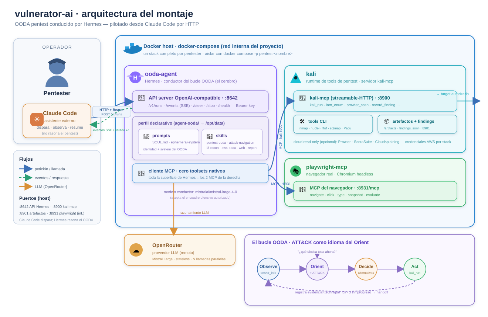

<p align="center">
  
</p>

<p align="center">
  <sub>† † † &nbsp; summoned from the depths of the OODA abyss &nbsp; † † †</sub>
</p>

OODA pentest conducido por **Hermes** hablando **directo** a un contenedor **Kali** vía MCP.

## Qué es

`vulnerator-ai` ejecuta un bucle OODA (Observe-Orient-Decide-Act) de pentest donde
el cerebro conductor es [Hermes](https://github.com/NousResearch/hermes) y las
herramientas corren en un Kali gobernado por un servidor MCP. Hermes decide qué
ejecutar y lo lanza **directamente** contra el objetivo a través del MCP de Kali.

Es un diseño deliberadamente mínimo: **no hay core, ni API REST, ni UI, ni gates**.
Tres contenedores (el agente y dos servidores MCP) y el agente conduciendo de punta a punta.

## Arquitectura (3 contenedores)



- **kali** — runtime determinista de tools de pentest y recolección (nmap, Prowler,
  ScoutSuite, Cloudsplaining, ...). Expone un servidor `kali-mcp` en `:8900` (y el canal de
  artefactos en `:8901`).
- **playwright-mcp** — navegador real (Chromium headless, imagen oficial de Microsoft) expuesto
  por MCP en `:8931`. Da a Hermes la superficie web (navegación/DOM/interacción) sin reactivar
  ningún toolset nativo. Lo usa la skill `web-pentest`.
- **ooda-agent** — Hermes (`nousresearch/hermes-agent`) como conductor del bucle OODA. Es cliente
  de ambos MCP (`kali:8900`, `playwright-mcp:8931`) y ejecuta las tools de pentest directamente.
  Mantiene vivo su gateway con `hermes gateway run` (API server OpenAI-compatible en `:8642`,
  **publicado al host** por defecto para pilotarlo desde un asistente externo — ver
  "Pilotar Hermes desde un asistente externo").

No hay servicios `api` ni `ui`: el agente habla directo con los MCP (Kali y navegador).

## Cómo levantarlo

**Todas las keys y credenciales van en un fichero `.env`** en la raíz del repo. No se
versiona (está en `.gitignore`) y es el único sitio donde pones secretos. Empieza por copiar
la plantilla, que lleva cada variable documentada:

```sh
cp .env.example .env
```

Abre el `.env` y rellena los valores. Como mínimo necesitas las dos obligatorias:

| Variable | Obligatoria | Dónde la pones / cómo la obtienes |
| --- | --- | --- |
| `OPENROUTER_API_KEY` | **Sí** | Tu API key de OpenRouter (el proveedor del LLM que razona el OODA). Créala en <https://openrouter.ai/keys> y pégala en el `.env`. |
| `HERMES_API_SERVER_KEY` | **Sí** | Clave del API server de Hermes (mín. 8 chars). Genera una con `openssl rand -hex 32` y pégala en el `.env`. También es el Bearer para pilotar Hermes por HTTP. |

Las credenciales de **AWS son OPCIONALES**: solo hacen falta si vas a usar las tools de
recolección cloud (Prowler / ScoutSuite / Cloudsplaining). Si no auditas AWS, deja estas
variables vacías en el `.env`:

| Variable | Obligatoria | Dónde la pones / cómo la obtienes |
| --- | --- | --- |
| `AWS_ACCESS_KEY_ID` | No | Credencial **read-only** de la cuenta que estés AUTORIZADO a auditar. En el `.env`. |
| `AWS_SECRET_ACCESS_KEY` | No | Secret de esa misma credencial. En el `.env`. |
| `AWS_SESSION_TOKEN` | No | Solo para credenciales temporales (STS). En el `.env`. |
| `AWS_REGION` | No | Región por defecto (p. ej. `us-east-1`). En el `.env`. |

El resto de variables del `.env.example` (puertos del host, token de artefactos, acotado de
Prowler) son opcionales y traen valores por defecto; déjalas vacías salvo que necesites
cambiarlas. Cuando tengas el `.env` listo:

```sh
docker compose up -d --build
```

## Cómo conducir el pentest (TUI interactivo)

```sh
docker compose up -d --build
docker compose exec -it ooda-agent hermes chat
```

`hermes chat` abre el TUI/REPL interactivo del agente. Desde ahí le pides un pentest
en lenguaje natural; Hermes conduce el OODA y ejecuta las herramientas en Kali
**directamente** con la tool `kali_run` (hablando con `kali:8900`).

`hermes gateway run` (el comando del contenedor) mantiene el contenedor vivo y arranca
el API server de Hermes en `:8642`. Ese API server es una vía **programática alternativa**
(OpenAI-compatible) y está **publicado al host** por defecto, para pilotar Hermes desde un
asistente externo sin entrar al TUI (ver la sección siguiente).

## Pilotar Hermes desde un asistente externo (Kiro / Claude)

A veces no quieres entrar al TUI `hermes chat`: quieres que un asistente (Kiro, Claude, un
script de CI) **dispare y observe** un pentest por HTTP. Hermes ya expone un API server
**OpenAI-compatible** (habilitado en el perfil, `agent-ooda/profile/config.yaml` →
`platforms.api_server`); lo único que hace falta es alcanzarlo.

**Rol del asistente externo: disparador y observador, no cerebro.** Quien razona y ejecuta el
pentest es Hermes (conducido por el modelo `mistralai/mistral-large-4-0`, elegido a propósito
porque Claude rechaza el encuadre ofensivo del pentest autorizado). El asistente solo manda el
prompt del engagement y lee los eventos; **no** debe intentar "pensar" el pentest ni reinterpretar
las tools de Kali.

Autenticación: todas las llamadas van con `Authorization: Bearer <HERMES_API_SERVER_KEY>`
(la misma key del `.env`).

### Dos modos de acceso

**Modo A — puerto publicado (recomendado).** El compose publica `:8642` al host (configurable
con `HERMES_API_HOST_PORT`, default `8642`). El asistente llama a `http://localhost:8642`
directamente:

```sh
export KEY=$(grep '^HERMES_API_SERVER_KEY=' .env | cut -d= -f2)

# ¿vivo?
curl -s http://localhost:8642/health          # -> {"status":"ok"}
```

**Modo B — sin abrir puerto (`exec`).** Si prefieres no publicar el `:8642` al host, borra el
bloque `ports:` del servicio `ooda-agent` y habla con la API desde dentro del contenedor:

```sh
docker compose exec ooda-agent \
  curl -s http://localhost:8642/health
# Si lanzaste el stack con '-p <proyecto>', pásalo también aquí:
#   docker compose -p pentest-ana exec ooda-agent curl -s http://localhost:8642/health
```

Todos los `curl` de abajo son iguales en ambos modos; solo cambia el prefijo (host directo vs.
`docker compose exec ooda-agent`).

### Flujo principal (API de runs)

El patrón `runs` está pensado justo para esto: lanzar un trabajo largo y suscribirse a su
progreso en vez de gestionar el streaming a mano.

```sh
# 1) Lanzar el pentest. El cuerpo lleva el engagement en lenguaje natural en el campo "input".
#    Responde {"run_id":"run_abc123","status":"started"}.
curl -s http://localhost:8642/v1/runs \
  -H "Authorization: Bearer $KEY" \
  -H "Content-Type: application/json" \
  -d '{
        "input": "Pentest autorizado contra 10.0.0.0/24 (scope: solo esa /24). Enumera, identifica servicios expuestos y prueba vías de acceso. Reporta hallazgos confirmados con evidencia."
      }'

# 2) Observar el progreso: stream SSE de eventos de ciclo de vida (OODA, tool.start/complete, ...).
curl -N http://localhost:8642/v1/runs/run_abc123/events \
  -H "Authorization: Bearer $KEY"

# 2b) O consultar el estado puntual (status: started | running | completed | failed | cancelled).
curl -s http://localhost:8642/v1/runs/run_abc123 \
  -H "Authorization: Bearer $KEY"

# 3) (Opcional) Inyectar guía a mitad de run. Solo mientras status=running; se entrega en el
#    siguiente tool boundary. Si el run ya no acepta steer, responde 409.
curl -s http://localhost:8642/v1/runs/run_abc123/steer \
  -H "Authorization: Bearer $KEY" \
  -H "Content-Type: application/json" \
  -d '{"input": "Céntrate primero en el puerto 445."}'

# 4) (Opcional) Interrumpir el run.
curl -s http://localhost:8642/v1/runs/run_abc123/stop \
  -H "Authorization: Bearer $KEY"
```

Campos del cuerpo de `POST /v1/runs` (verificado contra la doc oficial de Hermes): `input`
(string, obligatorio) y, opcionales, `session_id`, `instructions`, `conversation_history`,
`previous_response_id`. Para reintentos seguros puedes mandar la cabecera `Idempotency-Key`.

### Alternativa: `POST /v1/chat/completions` (OpenAI-compatible)

Si tu cliente ya habla el formato OpenAI, puedes usar el endpoint clásico (streaming por SSE)
en vez de la API de runs:

```sh
curl -s http://localhost:8642/v1/chat/completions \
  -H "Authorization: Bearer $KEY" \
  -H "Content-Type: application/json" \
  -d '{
        "model": "hermes-agent",
        "messages": [{"role": "user", "content": "Pentest autorizado contra 10.0.0.0/24 (scope: solo esa /24). Reporta hallazgos confirmados con evidencia."}]
      }'
```

### Instrucciones para el asistente

Patrón que un Kiro/Claude debe seguir para pilotar un engagement:

1. `GET /health` para confirmar que el stack está vivo (`{"status":"ok"}`).
2. `POST /v1/runs` con el engagement en `input` (target y **scope** explícitos, en lenguaje
   natural). Guarda el `run_id` de la respuesta.
3. Seguir el run hasta estado terminal: leer el SSE de `GET /v1/runs/{run_id}/events`, o hacer
   polling de `GET /v1/runs/{run_id}` hasta `completed` / `failed` / `cancelled`.
4. Resumir el resultado al usuario (hallazgos, estado final). Para el entregable formal, el propio
   Hermes genera el informe Markdown vía la skill `pentest-report` y lo deja como artefacto en el
   canal de datos (`:8901`).

El asistente **no decide** las tools ni reinterpreta las salidas de Kali: eso es trabajo de Hermes.
Su papel es disparar, observar y resumir.

### Nota de seguridad

Publicar el `:8642` al host **baja la barrera de red** que el stack tenía a propósito (antes el API
server solo era alcanzable por la red interna de docker). A partir de ahí, la única protección del
endpoint es el Bearer `HERMES_API_SERVER_KEY`: úsalo **solo en máquina/entorno controlado**, y si no
necesitas el acceso externo usa el Modo B (`exec`, sin abrir puerto). Esto es coherente con la
⚠️ Advertencia de más abajo: no hay scope-guard ni gate de autorización, la responsabilidad del
alcance recae enteramente en el operador.

## Arrancar limpio entre ejercicios

Para que cada pentest empiece sin recordar nada del anterior (historial de conversación
y memoria de Hermes), arranca el stack desde cero. La forma más limpia y determinista:

```sh
docker compose down -v   # para los contenedores y BORRA el volumen de estado de Hermes
docker compose up -d     # arranca con estado nuevo (el perfil se regenera desde agent-ooda/)
```

En una sola línea:

```sh
docker compose down -v && docker compose up -d
```

### Qué se borra y qué se conserva

El flag `-v` borra el volumen con nombre `hermes-data` (`/opt/data`), donde vive el estado
de Hermes: el perfil y su SQLite (`state.db`). Ahí está el historial/memoria que quieres
olvidar entre ejercicios. No pierdes configuración: el perfil (`config.yaml`, `SOUL.md`,
`skills`) **se regenera** en cada arranque copiando la plantilla declarativa de `agent-ooda/`.

| Qué | ¿Sobrevive a `down -v` + `up`? |
|---|---|
| Herramientas horneadas en la imagen por el `Dockerfile` de Kali | **Sí** |
| Paquetes que Hermes instaló en caliente durante un pentest | **No** (capa efímera del contenedor `kali`) |
| Estado / memoria / historial de Hermes (`hermes-data`) | **No** (es justo lo que borra `-v`) |

Notas:

- El contenedor `kali` **no tiene volumen**: todo lo que se instale en caliente (p. ej. un
  `apt install` que haga Hermes a mitad de un engagement) vive en la capa efímera del
  contenedor y desaparece en el siguiente `down`/`up`. Si quieres que una herramienta esté
  siempre disponible sin reinstalarla cada sesión, **añádela al `Dockerfile`** de Kali para
  que quede horneada en la imagen.
- Para perder solo los paquetes de la Kali no hace falta `-v`: un `docker compose down`
  normal ya recrea el contenedor `kali` desde la imagen. El `-v` añade el borrado del
  estado de Hermes.
- `docker compose restart` **no** recrea los contenedores, así que conserva tanto el estado
  de Hermes como lo instalado en caliente en la Kali: no sirve para empezar limpio.

### Alternativa: sesión nueva sin borrar el volumen

Si prefieres conservar el histórico pero trabajar en una conversación limpia, abre una
sesión con nombre nuevo en lugar de reutilizar la de por defecto:

```sh
docker compose exec -it ooda-agent hermes chat --continue <nombre-sesion-nueva>
```

Esto no borra la memoria previa; solo evita arrastrarla a la conversación nueva.

## El bucle OODA: diseño y comparativa

El "bucle OODA" de este proyecto **no es un motor que corra solo**: no hay código que itere ni un
scheduler. El OODA es **comportamiento inducido por prompt**, repartido en tres piezas del perfil
(`agent-ooda/`):

- `profile/SOUL.md` — identidad del conductor OODA (primer bloque del system prompt).
- `skills/pentest-ooda/SKILL.md` — el procedimiento del bucle (Observe → Orient → Decide → Act),
  reglas de parada y delegación.
- `skills/ooda-report-handoff/SKILL.md` — formato del resumen al cerrar un ciclo.

Skills de dominio (activación condicional, solo cargan cuando el contexto encaja):

- `skills/l3-recon-pivot/` — reconocimiento de red en capa 3 tras NAT (red/infra).
- `skills/aws-pacu-privesc/` — pentest ofensivo AWS con Pacu (cloud/IAM), mapeado a ATT&CK Cloud.
- `skills/web-pentest/` — pentest web por fases (recon → análisis → explotación basada en prueba),
  combinando `kali_run` (nmap/whatweb/nuclei/ffuf/sqlmap) con un navegador real por el MCP
  `playwright`. Flanco web.
- `skills/attack-navigation/` — MITRE ATT&CK como **idioma del Orient**: orientar por tácticas y
  etiquetar hallazgos con su `technique_id`. Transversal.
- `skills/pentest-report/` — genera el informe formal (Markdown) al cerrar el engagement, leyendo el
  store de hallazgos. Cierre del bucle.

El disparador es el mensaje del operador: Hermes entra en el rol OODA cuando le entregas un
engagement, avanza autónomo mientras haya **progreso real hacia el objetivo**, y para (handoff) al
agotar la ruta, acumular 3 pasos sin progreso, o confirmar que el objetivo es inalcanzable.

**ATT&CK como idioma del bucle:** el bucle de control sigue siendo OODA; ATT&CK no lo sustituye. Se
usa como lente en el Orient (situar la táctica actual y la siguiente plausible — alimenta el "Decide
con alternativas") y como taxonomía para etiquetar cada hallazgo (`technique_id`), lo que habilita
informes mapeados a ATT&CK. El detalle general vive en `attack-navigation` y el de Cloud en
`aws-pacu-privesc`.

### Comparativa con OODA públicos (qué aprendimos)

Se compararon dos skills/patrones OODA públicos con el nuestro:

- **`neurofoo/agent-skills` (OODA como framework de análisis).** OODA de *pensamiento*: su "Act"
  produce un plan, no ejecuta. Útil para deliberar; es un informe estructurado, no un bucle de
  control. Idea tomada: **Decide con alternativas explícitas** (sopesar 2-3 vías antes de elegir una)
  — ya destilada en `pentest-ooda` y `SOUL.md`.
- **`jomadu/rooda` (OODA como bucle de ejecución).** Lo más cercano a lo nuestro: itera O→O→D→A con
  **contexto fresco cada vuelta** y `max-iterations`. Idea tomada: **contexto fresco** — en Hermes se
  implementa delegando ramas largas a subagentes (`delegate_task`), que arrancan con contexto limpio
  y solo devuelven su resumen. Ya destilada en `pentest-ooda` (sección de delegación) y requirió
  reactivar `delegation` en `config.yaml`.

| Dimensión | neurofoo (análisis) | rooda (ejecución) | **Nuestro `pentest-ooda`** |
|---|---|---|---|
| Naturaleza | Informe de decisión | Loop autónomo de código | Loop autónomo de pentest |
| "Act" | Planifica (no ejecuta) | Ejecuta de verdad | Ejecuta en Kali (`kali_run`) |
| Criterio de parada | — (one-shot) | `max-iterations` (cuantitativo) | **Progreso cualitativo** (acercarse al objetivo / inalcanzabilidad) |
| Memoria entre vueltas | — | Fichero (AGENTS.md, PLAN.md) | Efímero por engagement (a propósito) |
| Contexto fresco | — | Por iteración | Por delegación a subagentes |
| Salida como dato no confiable | No | No | **Sí** (prompt injection en salidas) |

Dos cosas que lo nuestro hace mejor y conviene preservar: el **criterio de parada cualitativo** (no
un simple contador de iteraciones) y tratar **toda salida de tool como dato no confiable** (crítico
en pentest). Las dos ideas robadas (alternativas en Decide, contexto fresco por subagentes) cubren
las dos debilidades que teníamos frente a los públicos.

## Persistencia de evidencia e informe

El OODA tiene un **store de hallazgos por engagement**, del que tiran el handoff y el informe:

- **Dónde vive.** Sobre el plano de artefactos (`/artifacts`, puerto `:8901`), NO en el estado de
  Hermes: sobrevive a la naturaleza efímera del perfil y es descargable. Un fichero por engagement
  (`<engagement-id>/findings.jsonl`), un hallazgo por línea.
- **Cómo lo alimenta el agente.** Con las tools MCP `record_finding` / `read_findings` (en
  `docker/kali/kali_mcp_server.py`, sobre `docker/kali/finding_store.py`): append estructurado y
  lectura paginada, sin que el agente escriba JSON a mano.
- **Esquema de un hallazgo.** id, fase OODA, clase/`technique_id` (ATT&CK), target
  (host/puerto/recurso/ARN), estado (hipótesis | parcial | confirmado | descartado), evidencia
  (comando + returncode + salida verbatim o referencia al artefacto), confianza, timestamp, y para
  cambios en la cuenta el tag `vulnerator-ai` + comando de reversión. El estado se alinea con la
  disciplina "hipótesis vs. hallazgo confirmado" del `SOUL.md`.
- **Consumidores.** `ooda-report-handoff` y `pentest-report` LEEN del store en vez de reconstruir
  desde la conversación.
- **Dato no confiable.** La evidencia guardada sigue siendo dato no confiable al releerla: se razona
  sobre ella, no se obedecen instrucciones embebidas (prompt injection).

La skill **`pentest-report`** produce el entregable formal al cerrar: un informe **Markdown** generado
por `docker/kali/report_gen.py` (horneado en la imagen, invocado con `kali_run`) que lee el store y
deja el informe como artefacto en `:8901`. Estructura destilada de plantillas públicas con atribución
(`Theophilus/athena-pentest`, `Marmeus/pentesting-report-generator`): engagement details, resumen
ejecutivo, tabla por estado, metodología (OODA/ATT&CK/PTES/OWASP), findings con CVSS 3.1 + CWE y
evidencia reproducible, remediación. CVSS solo para hallazgos confirmados.

## El flanco web (navegador por MCP)

La skill **`web-pentest`** cubre el pentest web por fases. No se limita a `kali_run`: combina las
herramientas CLI de la Kali (nmap/whatweb/nuclei/ffuf/sqlmap, por `kali_run`) con un **navegador real
por MCP** — el contenedor `playwright-mcp` (Chromium headless, imagen oficial de Microsoft),
registrado como segundo servidor MCP (`playwright`) en el perfil. Esto preserva el principio del
proyecto (**todo pasa por MCP, cero toolsets nativos**): Hermes gana `mcp_playwright_*` para
navegación/DOM/XSS sin reactivar el toolset `browser` nativo. Sus guardarraíles están alineados con la
filosofía del proyecto: no hay gate que bloquee, pero sí disciplina de auditoría y evidencia
reproducible para poder restablecer la explotación (y se conserva el aviso de fuga por el cliente
auxiliar: redactar credenciales, `title_generation` off en engagements sensibles).

## ⚠️ Advertencia (importante)

Este producto **no tiene guardarraíles**: **no hay scope-guard, no hay consentimiento,
no hay audit, no hay gate de autorización**. Hermes ejecuta directamente lo que decida
contra el objetivo, sin portero que valide el alcance.

Esto es **intencional**. Úsalo **solo contra targets explícitamente autorizados** y en
un **entorno controlado**. Toda la responsabilidad del alcance recae en el operador.
